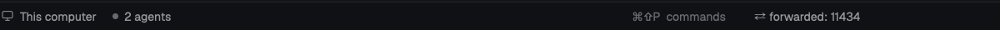

# herdr-port-forward



Port forwarding for [Herdr](https://herdr.dev) ssh machines, like VS Code / Cursor: ports opened from herdr terminals are forwarded automatically, any other port can be added by hand. Click the bar for a Ports panel: port, forwarded address, running process, origin, close buttons, Add Port and Refresh.

## Install

Copy `mods/port-forward` to `~/.config/herdr-app/mods/`, then add a block to a layout (clone one first), e.g. in the status row:

```json
{ "id": "pf", "type": "block", "size": { "px": 260 }, "content": { "mod": "port-forward" } }
```

Check it: `herdr-app check ~/.config/herdr-app/mods/port-forward`

See `RECIPE.md` for behavior and limits.
